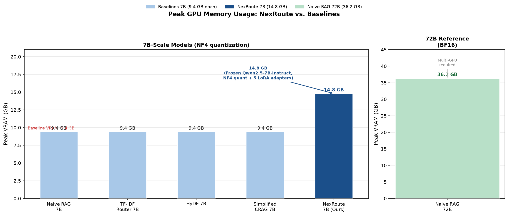
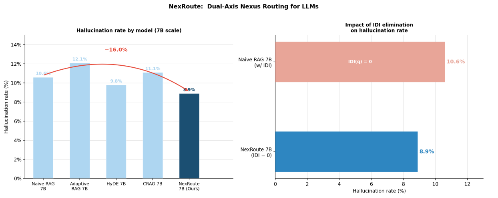

# NexRoute 

> **NexRoute: A Dual-Axis Nexus Routing Framework for Adaptive Expert Selection in Cross-Domain Large Language Models**

---

## Overview

Cross-domain queries expose a fundamental failure mode in retrieval-augmented generation: when a query spans multiple domains (e.g., medical ethics intersecting legal liability), lexical retrieval returns plausible-sounding but domain-misaligned documents, and a single LoRA expert lacks the composite specialization needed to synthesize them correctly. This produces **factually coherent but semantically incorrect outputs** — a mismatch that standard RAG pipelines cannot detect.

**NexRoute** addresses this by routing each query through two independent axes simultaneously:

| Axis | Categories | Role |
|------|-----------|------|
| **Domain Axis** | MED / LAW / STEM / SOC | *What field does this query belong to?* |
| **Function Axis** | WHAT / HOW / WHY / COMPARE | *What is the user's reasoning intent?* |

The intersection of these two axes — the **Nexus Point** — determines whether a query requires cross-domain expert activation and triggers partitioned retrieval with inter-domain interference (IDI) filtering. This structural decomposition is the key mechanism by which NexRoute suppresses hallucination and improves generation quality on cross-domain queries.

---

## Motivation


**Figure 1** illustrates the core failure mode NexRoute is designed to solve. Track A (semantic expert routing) and Track B (lexical retrieval via FAISS) operate independently in standard RAG systems. When their outputs conflict — the expert is domain-specialized but the retrieved context is lexically similar yet domain-misaligned — the LLM context window receives contradictory signals, producing mismatch and hallucination. NexRoute eliminates this by coupling retrieval partitioning to the router's domain signal, so the retrieved documents always align with the activated expert's specialization.

---

## Architecture


**Figure 2** shows the end-to-end NexRoute pipeline:

1. **DeBERTa Dual-Axis Router** — A DeBERTa-large encoder with two independent classification heads:
   - *Domain Axis*: outputs domain scores via softmax → scaffold $S_f^d$
   - *Function Axis*: outputs intent scores via argmax → intent label $d^*$, function scores $f$

2. **Nexus Point** — Evaluates `isCross(q)`: if the query spans domain boundaries (cross-domain flag = True), the pipeline activates cross-domain retrieval and the `e_CROSS` expert. Otherwise, it routes to the matched single-domain expert.

3. **Partitioned Retrieval** — FAISS-backed retrieval (Top-K=10) with IDI(q)=0 filtering, which eliminates inter-domain interference by restricting retrieved documents to the predicted domain partition.

4. **Prompt Scaffolding** — Constructs a chain-of-thought scaffold from the query, domain scaffold $S_f^d$, and domain label $C_d$, structured as the tuple $(q,\ S_f^d,\ C_d)$.

5. **Frozen LLM Backbone** — Qwen2.5-7B-Instruct (frozen weights), extended by domain-specific LoRA adapters:
   - `e_LAW`, `e_MED`, `e_SOC`, `e_STEM` — single-domain experts (LoRA rank=16, alpha=32)
   - `e_CROSS` — activated exclusively when `isCross(q) = True`

6. **Response H** — Final generated output, grounded in the partitioned retrieval context and structured by the function-aware scaffold.

---

## Results

### Generation Quality on CROSS-Domain Benchmark



**Figure 3** reports ROUGE-L, BERTScore (RoBERTa-Large), and BLEU-4 on the adapter-unseen Clean-300 subset (60 CROSS + 240 Single, indices 0–299) and 72B large-scale references. Key findings:

- **NexRoute 7B** achieves **ROUGE-L 28.23 / BERTScore 89.66 / BLEU-4 12.19** on CROSS-domain queries (Clean-300), outperforming all 7B baselines including Naive RAG, TF-IDF Router, HyDE, and Simplified CRAG by at least +6.06 pp ROUGE-L (Holm-corrected *p* < 0.001).
- **NexRoute 72B** achieves **ROUGE-L 30.76 / BERTScore 90.96 / BLEU-4 13.64**, establishing the strongest result across both parameter scales.
- On single-domain queries, NexRoute leads all 7B models (ROUGE-L 26.20 / BERTScore 88.55), with overall ROUGE-L 26.61 and BERTScore 88.77 (Cohen's *d* = 0.61–0.73 vs. baselines).

---

### CROSS-Domain Performance — Visual Comparison


**Figure 4** visualizes CROSS-domain BERTScore (left) and ROUGE-L (right) across all models at 7B and 72B scales. The red dashed line marks the Naive RAG 72B reference (BERTScore 89.03 / ROUGE-L 28.81).

- **NexRoute 7B** (BERTScore 89.66, ROUGE-L 28.23) surpasses the 72B Naive RAG reference (BERTScore 89.03 / ROUGE-L 28.81) with less than one-tenth the parameters, demonstrating that structural routing partially substitutes for raw parameter scale on cross-domain tasks.
- **NexRoute 72B** (BERTScore 90.96, ROUGE-L 30.76) establishes the absolute upper bound across all evaluated configurations.
- HyDE 7B shows the lowest ROUGE-L among 7B models (20.78), indicating that hypothetical document expansion without domain partitioning is counter-productive for cross-domain queries.

---

### Factuality — NLI Contradiction Rate



**Figure 5** reports sentence-level NLI contradiction rates (lower = fewer hallucinated sentences) evaluated via `cross-encoder/nli-deberta-v3-large` against top-3 retrieved passages across the Full-500 evaluation set.

**Left — NLI contradiction rate by model (7B scale):**

| Model | Overall (%) | CROSS (%) | Single (%) |
|-------|:-----------:|:---------:|:----------:|
| TF-IDF Router 7B | 11.7 | 4.7 | 13.6 |
| HyDE 7B | 11.0 | 6.0 | 12.5 |
| Naive RAG 7B | 10.8 | 5.7 | 12.3 |
| NexRoute 7B (Ours) | 10.1 | **3.6** | 13.6 |
| **Simplified CRAG 7B** | **9.8** | 3.8 | **11.6** |

NexRoute achieves the **lowest CROSS-domain NLI contradiction rate** (3.6%) among all 7B models, with a statistically significant reduction vs. HyDE (Δ−2.52 pp, *p* = 0.021). Overall rate (10.1%) does not outperform Simplified CRAG; no overall-best factuality claim is made.

**Right — Impact of domain-partitioned retrieval (ablation V03):**

Removing domain-partitioned retrieval (V03) raises CROSS NLI contradiction by **+3.20 pp** (*p* = 0.045; 95% CI [+0.09, +6.43]), isolating the evidence-scope control contribution of partitioned retrieval independently of the LoRA expert effect.

---

### Ablation Study


**Figure 6** (Table 3 and Table 4 in the paper) quantifies the contribution of each NexRoute component evaluated on all 500 queries.

**Table 3** — NLI contradiction rates confirm that domain-partitioned retrieval (V03) specifically controls CROSS-domain factuality: removal raises CROSS NLI by +3.20 pp (*p* = 0.045).

**Table 4** — Component ablation (V01–V05):

| Variant | Removed Component | ROUGE-L | Δ ROUGE-L | BERTScore | Δ BERTScore |
|---------|------------------|:-------:|:---------:|:---------:|:-----------:|
| **V01** | **Full NexRoute** | **27.83** | **—** | **87.96** | **—** |
| V02 | Function Scaffold | 26.51 | −1.32*** | 87.80 | −0.16* |
| V03 | Partitioned Retrieval | 26.26 | −1.57*** | 87.64 | −0.32*** |
| V04 | LoRA Adapters | 18.40 | −9.43*** | 85.09 | −2.87*** |
| V05 | Domain Axis | 16.90 | −10.93*** | 84.71 | −3.25*** |

LoRA adapter removal (V04) causes the largest generation quality drop (−9.43 pp ROUGE-L). Partitioned retrieval (V03) specifically controls CROSS factuality. Function scaffold (V02) contributes a modest but robust +1.32 pp ROUGE-L boost (*p* < 0.001).

---

## Key Results Summary

CROSS-domain results are from the adapter-unseen Clean-300 subset (*n*=60 CROSS). NLI Contr. = sentence-level NLI contradiction rate (Full-500, lower is better; CROSS column).

| Model | CROSS ROUGE-L | CROSS BERTScore | CROSS BLEU-4 | NLI Contr. (CROSS) |
|-------|:-------------:|:---------------:|:------------:|:------------------:|
| Naive RAG 7B | 21.76 | 87.75 | 7.36 | 5.7% |
| TF-IDF Router 7B | 22.17 | 87.84 | 7.40 | 4.7% |
| HyDE 7B | 20.78 | 87.67 | 6.97 | 6.0% |
| Simplified CRAG 7B | 21.72 | 87.84 | 7.35 | 3.8% |
| **NexRoute 7B (Ours)** | **28.23** | **89.66** | **12.19** | **3.6%** |
| Naive RAG 72B | 28.81 | 89.03 | 13.27 | — |
| **NexRoute 72B (Ours)** | **30.76** | **90.96** | **13.64** | — |

> NexRoute 7B surpasses the Naive RAG 72B reference on all CROSS-domain generation metrics while operating at less than one-tenth the parameter scale.

---

## Prediction Files — Column Reference (`preds_500.csv`)

`preds_500.csv` contains per-sample routing predictions and metadata for all 500 evaluation queries.

| Column | Description | Paper reference |
|--------|-------------|-----------------|
| `pred_domain_nexroute` | Domain prediction from the DeBERTa-large dual-axis router (NexRoute) | **Table 4 — NexRoute column** |
| `pred_domain_tfidf_lr` | Domain prediction from the TF-IDF + Logistic Regression 5-class classifier (`adaptive_tfidf_router.pkl`) | **Table 4 — TF-IDF Router column** |
| `pred_domain_hybridrouter` | Domain prediction from `HybridRouter` (`routers/domain_router/pipeline.pkl`): TF-IDF + keyword features + threshold-based CROSS detection. **Not used in paper experiments.** See note below. | — |

> **Note on `pred_domain_hybridrouter`:** `HybridRouter` is a development-phase prototype stored in `routers/domain_router/pipeline.pkl`. It determines CROSS by checking whether the top-1 class probability is below a fixed threshold (0.50) rather than training CROSS as a fifth class. It achieves 80.8% overall accuracy with only 37% CROSS recall, and is **not the TF-IDF Domain Router baseline reported in the paper**. The paper baseline (`TF-IDF+LR`, Table 4) is the 5-class logistic regression in `adaptive_tfidf_router.pkl` (83.4% overall, 96% CROSS recall). `HybridRouter` is retained for reference; do not use `pred_domain_hybridrouter` for paper comparisons.

> **Note on `audit_summary_hybridrouter.json`:** This file (generated 2026-08-05) aggregates `pred_domain_hybridrouter` predictions and reflects HybridRouter accuracy (80.8% total, CROSS 37%). It does **not** correspond to Table 4.

---

## Dataset Version Note

> **For reviewers and reproducibility:** The submitted manuscript reports **15,744 dual-annotated router training samples**. After submission, a post-hoc audit revealed that 178 queries from the GT-500 evaluation benchmark had been inadvertently included in the router training split (35.6% overlap), along with 125 duplicate entries — totaling 303 items removed from `router_train` and 60 items removed from `router_val`/`router_test`. The current repository reflects the **cleaned version** (`router_train`: 17,553 items; `router_val`: 2,199; `router_test`: 2,205).
>
> The contamination affected **router classification training only**. Generation quality metrics (ROUGE-L, BERTScore, BLEU-4) depend on the LoRA generator, which was trained on separate domain corpora and is not affected by this cleanup. The external validation on MedQuAD (n=200) has zero overlap with the router training data and is unaffected.
>
> The cleaned router splits are now tracked under `processed_v2/router_{train,val,test}.json`.

---

## Repository Structure

```
NexRoute/
├── paper/
│   └── main_final.tex              # LaTeX manuscript (Neurocomputing submission)
│
├── src/                            # Core pipeline
│   ├── pipeline.py                 # End-to-end NexRoute pipeline
│   ├── nexroute_router.py          # DeBERTa dual-axis router
│   ├── inference.py                # Development-phase DualMoE prototype (HybridRouter + ablation modes)
│   │                              # NOT used in paper experiments; superseded by DeBERTa router
│   └── dataset.py                  # Dataset loading and preprocessing
│
├── data/                           # Data preparation
│   ├── load_datasets.py            # HuggingFace dataset loaders
│   ├── rewrite_mcq.py              # MCQ → open-ended rewriting
│   ├── generate_law_med_cross.py   # Cross-domain benchmark generation
│   ├── build_router_data.py        # Router training data construction
│   ├── make_gt_500.py              # 500-sample ground truth assembly
│   ├── gen_queryset.py             # Query set sampling
│   └── cross_synthesis_repro.py    # Cross-domain synthesis reproducibility
│
├── train/                          # Training scripts
│   ├── train_deberta_router.py     # Dual-axis DeBERTa router training
│   ├── train_lora_7b_fixed.py      # Domain LoRA expert training (Qwen2.5-7B)
│   └── train_adaptive_tfidf.py     # Adaptive TF-IDF retrieval training
│
├── baselines/                      # Baseline implementations
│   ├── naive_rag.py                # Naive RAG (shared FAISS index)
│   ├── adaptive_rag.py             # Adaptive RAG
│   ├── self_rag.py                 # Self-RAG
│   └── single_lora_rag.py          # Single LoRA + RAG (no routing)
│
├── eval/                           # Evaluation scripts
│   ├── eval_baselines_500.py       # 7B baseline eval (500-sample CROSS)
│   ├── eval_baselines_72b_500.py   # 72B baseline eval
│   ├── eval_arrow_phatgoose.py     # Token-level MoE routing baselines
│   ├── eval_factscore_hallucination.py  # FActScore hallucination eval
│   ├── eval_all_metrics_paper.py   # Full metric suite (ROUGE-L, BERTScore, BLEU-4)
│   ├── eval_hallucination_paper.py # Paper hallucination analysis
│   ├── measure_latency_full.py     # Inference latency profiling
│   └── case_study_inference.py     # Qualitative case study generation
│
├── configs/
│   ├── ds_config_zero3.json        # DeepSpeed ZeRO-3 training config
│   └── router_twostage_v2_config.json  # Two-stage router config
│
├── scripts/
│   ├── run_cross.sh                # CROSS-domain evaluation runner
│   ├── run_mmlu_eval.sh            # MMLU subset evaluation runner
│   ├── run_all_mmlu.sh             # Full MMLU suite runner
│   └── run_ablation_pipeline.sh    # Ablation study pipeline
│
├── eval_data/                      # Evaluation benchmarks (500 samples each)
│   ├── cross_mmlu.json
│   ├── law_mmlu.json
│   ├── med_mmlu.json
│   ├── soc_mmlu.json
│   └── stem_mmlu.json
│
├── routers/
│   ├── nexroute_router/            # DeBERTa dual-axis router checkpoint (paper Table 4 — NexRoute)
│   ├── domain_router/
│   │   └── pipeline.pkl           # HybridRouter prototype — NOT used in paper experiments
│   │                              # (TF-IDF + keyword + threshold CROSS; see preds_500.csv note)
│   └── func_router/
│       └── pipeline.pkl           # Function-axis TF-IDF+SVM classifier
│
└── figure/                         # Paper figures
    ├── 1.png                       # Fig. 1: Motivation — Mismatch mechanism
    ├── 2.png                       # Fig. 2: NexRoute architecture pipeline
    ├── 3.png                       # Fig. 3: Quantitative results table
    ├── 4.png                       # Fig. 4: CROSS-domain BERTScore / ROUGE-L bar charts
    ├── 5.png                       # Fig. 5: Hallucination rate + IDI elimination effect
    └── 6.png                       # Fig. 6: FActScore table + ablation study
```

---

## Installation

```bash
git clone https://github.com/kong276818/NexRoute.git
cd NexRoute
pip install torch transformers peft datasets faiss-cpu
```

**Requirements**
- Python 3.10+
- PyTorch 2.0+
- transformers >= 4.40
- peft >= 0.10
- faiss-cpu or faiss-gpu
- datasets

---

## Usage

### 1. Build Router Training Data

```bash
python data/build_router_data.py \
  --domains MED LAW STEM SOC \
  --output_dir data/processed/
```

### 2. Train the DeBERTa Dual-Axis Router

```bash
python train/train_deberta_router.py \
  --data_dir data/processed/ \
  --model_name microsoft/deberta-large \
  --epochs 5 \
  --batch_size 32
```

### 3. Train Domain LoRA Experts

```bash
# Repeat for each domain: MED, LAW, STEM, SOC, CROSS
python train/train_lora_7b_fixed.py \
  --domain MED \
  --base_model Qwen/Qwen2.5-7B-Instruct \
  --lora_rank 16 \
  --lora_alpha 32 \
  --deepspeed configs/ds_config_zero3.json
```

### 4. Run Evaluation

```bash
# CROSS-domain benchmark (500 samples)
bash scripts/run_cross.sh

# MMLU domain subsets
bash scripts/run_mmlu_eval.sh

# Hallucination (FActScore)
python eval/eval_factscore_hallucination.py \
  --checkpoint routers/nexroute_router \
  --lora_dir lora_weights/
```

### 5. Single-Query Inference

```bash
python src/inference.py \
  --query "Is off-label drug prescribing legal for pediatric patients?" \
  --router routers/nexroute_router \
  --lora_dir lora_weights/
```

---

## Citation

```bibtex
@article{kong2026nexroute,
  title   = {NexRoute: A Dual-Axis Nexus Routing Framework for Adaptive
             Expert Selection in Cross-Domain Large Language Models},
  author  = {Kong, Junyoung and Ha, Youngguk},
  journal = {Neurocomputing},
  year    = {2026},
  note    = {Under Submission}
}
```

---

## Authors

| Name | Affiliation | Role |
|------|------------|------|
| **Jun-young Kong** | Konkuk University | First Author |
| **Young-guk Ha** | Konkuk University | Corresponding Author |

---

## Copyright

© 2026 Junyoung Kong, Konkuk University, Seoul, Republic of Korea. All rights reserved.  
Unauthorized use, reproduction, or distribution of this code or manuscript is prohibited.
