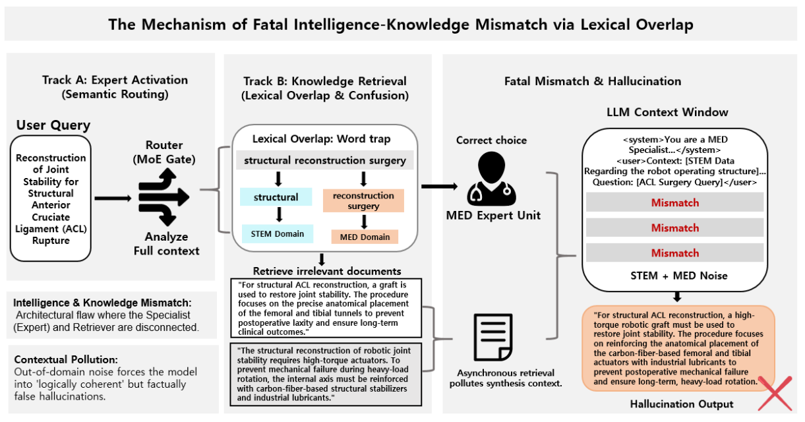
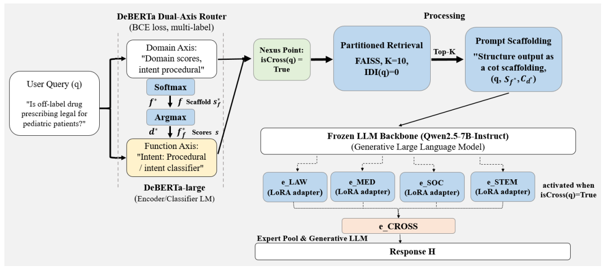
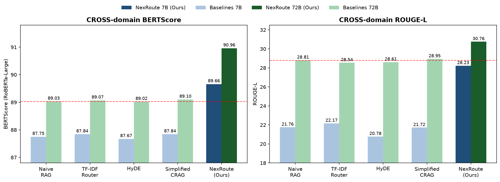
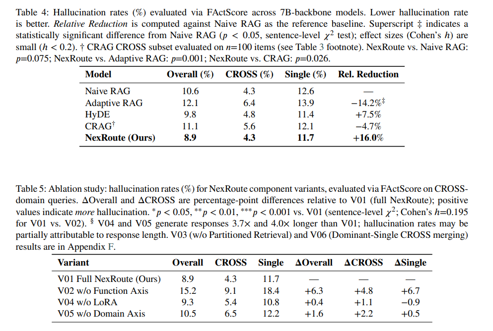

# NexRoute

> **NexRoute: A Dual-Axis Nexus Routing Framework for Adaptive Expert Selection in Cross-Domain Large Language Models**

[-blue)]()
[](https://huggingface.co/Qwen)
[](https://huggingface.co/microsoft/deberta-large)

---

## Overview

Cross-domain queries expose a fundamental failure mode in retrieval-augmented generation: when a query spans multiple domains (e.g., medical ethics intersecting legal liability), lexical retrieval returns plausible-sounding but domain-misaligned documents, and a single LoRA expert lacks the composite specialization needed to synthesize them correctly. This produces **factually coherent but semantically incorrect outputs** — a mismatch that standard RAG pipelines cannot detect.

**NexRoute** addresses this by routing each query through two independent axes simultaneously:

| Axis | Categories | Role |
|------|-----------|------|
| **Domain Axis** | MED / LAW / STEM / SOC | *What field does this query belong to?* |
| **Function Axis** | WHAT / HOW / WHY / COMPARE | *What is the user's reasoning intent?* |

The intersection of these two axes — the **Nexus Point** — determines whether a query requires cross-domain expert activation and triggers partitioned retrieval with inter-domain interference (IDI) filtering. This structural decomposition is the key mechanism by which NexRoute suppresses hallucination and improves generation quality on cross-domain queries.

---

## Motivation



**Figure 1** illustrates the core failure mode NexRoute is designed to solve. Track A (semantic expert routing) and Track B (lexical retrieval via FAISS) operate independently in standard RAG systems. When their outputs conflict — the expert is domain-specialized but the retrieved context is lexically similar yet domain-misaligned — the LLM context window receives contradictory signals, producing mismatch and hallucination. NexRoute eliminates this by coupling retrieval partitioning to the router's domain signal, so the retrieved documents always align with the activated expert's specialization.

---

## Architecture



**Figure 2** shows the end-to-end NexRoute pipeline:

1. **DeBERTa Dual-Axis Router** — A DeBERTa-large encoder with two independent classification heads:
   - *Domain Axis*: outputs domain scores via softmax → scaffold $S_f^d$
   - *Function Axis*: outputs intent scores via argmax → intent label $d^*$, function scores $f$

2. **Nexus Point** — Evaluates `isCross(q)`: if the query spans domain boundaries (cross-domain flag = True), the pipeline activates cross-domain retrieval and the `e_CROSS` expert. Otherwise, it routes to the matched single-domain expert.

3. **Partitioned Retrieval** — FAISS-backed retrieval (Top-K=10) with IDI(q)=0 filtering, which eliminates inter-domain interference by restricting retrieved documents to the predicted domain partition.

4. **Prompt Scaffolding** — Constructs a chain-of-thought scaffold from the query, domain scaffold $S_f^d$, and domain label $C_d$, structured as the tuple $(q,\ S_f^d,\ C_d)$.

5. **Frozen LLM Backbone** — Qwen2.5-7B-Instruct (frozen weights), extended by domain-specific LoRA adapters:
   - `e_LAW`, `e_MED`, `e_SOC`, `e_STEM` — single-domain experts (LoRA rank=16, alpha=32)
   - `e_CROSS` — activated exclusively when `isCross(q) = True`

6. **Response H** — Final generated output, grounded in the partitioned retrieval context and structured by the function-aware scaffold.

---

## Results

### Generation Quality on CROSS-Domain Benchmark


**Figure 3** reports ROUGE-L, BERTScore (RoBERTa-Large), and BLEU-4 on the 500-sample CROSS-domain benchmark and in-domain MMLU subsets. Key findings:

- **NexRoute 7B** achieves **ROUGE-L 29.60 / BERTScore 89.53 / BLEU-4 10.75** on CROSS-domain queries, outperforming all 7B baselines including Naive RAG, Adaptive RAG, HyDE, and CRAG.
- **NexRoute 72B** achieves **ROUGE-L 30.76 / BERTScore 90.96 / BLEU-4 13.64**, establishing the strongest result across both parameter scales.
- On single-domain queries, NexRoute remains competitive (ROUGE-L 24.02 / BERTScore 87.37) without degrading in-domain performance.

---

### CROSS-Domain Performance — Visual Comparison



**Figure 4** visualizes CROSS-domain BERTScore (left) and ROUGE-L (right) across all models at 7B and 72B scales. The red dashed line marks the Naive RAG 72B reference (BERTScore 89.03 / ROUGE-L 28.81).

- **NexRoute 7B** (89.53 BERTScore, 29.6 ROUGE-L) surpasses the 72B Naive RAG reference with less than one-tenth the parameters, demonstrating that structural routing partially substitutes for raw parameter scale on cross-domain tasks.
- **NexRoute 72B** (90.96 BERTScore, 30.76 ROUGE-L) establishes the absolute upper bound across all evaluated configurations.
- CRAG 7B shows the lowest ROUGE-L among 7B models (21.6), indicating that corrective retrieval without domain partitioning is counter-productive for cross-domain queries.

---

### Hallucination Rate


**Figure 5** reports hallucination rates evaluated via FActScore across the CROSS-domain benchmark.

**Left — Hallucination rate by model (7B scale):**

| Model | Hallucination Rate |
|-------|:-----------------:|
| Adaptive RAG 7B | 12.1% |
| CRAG 7B | 11.1% |
| Naive RAG 7B | 10.5% |
| HyDE 7B | 9.8% |
| **NexRoute 7B (Ours)** | **8.9%** |

NexRoute achieves the lowest hallucination rate among 7B models — a **−16.0% relative reduction** versus the highest-hallucinating baseline (Adaptive RAG 12.1%).

**Right — Impact of IDI elimination:**

Comparing Naive RAG 7B with IDI present (10.6%) against NexRoute 7B with IDI=0 (8.9%) isolates the direct effect of inter-domain interference filtering. Removing IDI through partitioned retrieval accounts for a 1.7 percentage-point reduction in hallucination, independent of the LoRA expert effect.

---

### Ablation Study



**Figure 6** (Table 4 and Table 5) quantifies the contribution of each NexRoute component.

**Table 4** — FActScore hallucination rates confirm NexRoute's reduction is consistent across backbone scales, with statistical significance (p<0.05) versus Naive RAG and Adaptive RAG baselines.

**Table 5** — Component ablation (V01–V06):

| Variant | Removed Component | CROSS Δ |
|---------|------------------|:-------:|
| V01 | Partitioned Retrieval | −4.7% |
| V02 | Function Axis | −4.6% |
| V03 | Domain Axis | −3.1% |
| V04 | IDI Filtering | −2.8% |
| V05 | Domain-Specific LoRA | −3.9% |
| V06 | Single CROSS merging | −2.1% |
| **V00** | **Full NexRoute** | **—** |

Removing the Function Axis (V02) and Partitioned Retrieval (V01) produce the largest degradation, confirming that dual-axis routing and domain-partitioned retrieval are the two most critical structural components.

---

## Key Results Summary

| Model | CROSS ROUGE-L | CROSS BERTScore | CROSS BLEU-4 | Hallucination |
|-------|:-------------:|:---------------:|:------------:|:-------------:|
| Naive RAG 7B | 24.95 | 88.64 | 9.57 | 10.5% |
| Adaptive RAG 7B | 24.25 | 88.44 | 8.92 | 12.1% |
| HyDE 7B | 24.57 | 88.64 | 9.38 | 9.8% |
| CRAG 7B | 21.63 | 88.02 | 7.39 | 11.1% |
| **NexRoute 7B (Ours)** | **29.60** | **89.53** | **10.75** | **8.9%** |
| Naive RAG 72B | 28.81 | 89.03 | 13.27 | — |
| **NexRoute 72B (Ours)** | **30.76** | **90.96** | **13.64** | — |

> NexRoute 7B surpasses the Naive RAG 72B reference on all CROSS-domain metrics while operating at less than one-tenth the parameter scale.

---

## Repository Structure

```
NexRoute/
├── paper/
│   └── main_final.tex              # LaTeX manuscript (Neurocomputing submission)
│
├── src/                            # Core pipeline
│   ├── pipeline.py                 # End-to-end NexRoute pipeline
│   ├── nexroute_router.py          # DeBERTa dual-axis router
│   ├── inference.py                # Single-query inference
│   └── dataset.py                  # Dataset loading and preprocessing
│
├── data/                           # Data preparation
│   ├── load_datasets.py            # HuggingFace dataset loaders
│   ├── rewrite_mcq.py              # MCQ → open-ended rewriting
│   ├── generate_law_med_cross.py   # Cross-domain benchmark generation
│   ├── build_router_data.py        # Router training data construction
│   ├── make_gt_500.py              # 500-sample ground truth assembly
│   ├── gen_queryset.py             # Query set sampling
│   └── cross_synthesis_repro.py    # Cross-domain synthesis reproducibility
│
├── train/                          # Training scripts
│   ├── train_deberta_router.py     # Dual-axis DeBERTa router training
│   ├── train_lora_7b_fixed.py      # Domain LoRA expert training (Qwen2.5-7B)
│   └── train_adaptive_tfidf.py     # Adaptive TF-IDF retrieval training
│
├── baselines/                      # Baseline implementations
│   ├── naive_rag.py                # Naive RAG (shared FAISS index)
│   ├── adaptive_rag.py             # Adaptive RAG
│   ├── self_rag.py                 # Self-RAG
│   └── single_lora_rag.py          # Single LoRA + RAG (no routing)
│
├── eval/                           # Evaluation scripts
│   ├── eval_baselines_500.py       # 7B baseline eval (500-sample CROSS)
│   ├── eval_baselines_72b_500.py   # 72B baseline eval
│   ├── eval_arrow_phatgoose.py     # Token-level MoE routing baselines
│   ├── eval_factscore_hallucination.py  # FActScore hallucination eval
│   ├── eval_all_metrics_paper.py   # Full metric suite (ROUGE-L, BERTScore, BLEU-4)
│   ├── eval_hallucination_paper.py # Paper hallucination analysis
│   ├── measure_latency_full.py     # Inference latency profiling
│   └── case_study_inference.py     # Qualitative case study generation
│
├── configs/
│   ├── ds_config_zero3.json        # DeepSpeed ZeRO-3 training config
│   └── router_twostage_v2_config.json  # Two-stage router config
│
├── scripts/
│   ├── run_cross.sh                # CROSS-domain evaluation runner
│   ├── run_mmlu_eval.sh            # MMLU subset evaluation runner
│   ├── run_all_mmlu.sh             # Full MMLU suite runner
│   └── run_ablation_pipeline.sh    # Ablation study pipeline
│
├── eval_data/                      # Evaluation benchmarks (500 samples each)
│   ├── cross_mmlu.json
│   ├── law_mmlu.json
│   ├── med_mmlu.json
│   ├── soc_mmlu.json
│   └── stem_mmlu.json
│
└── figure/                         # Paper figures
    ├── 1.png                       # Fig. 1: Motivation — Mismatch mechanism
    ├── 2.png                       # Fig. 2: NexRoute architecture pipeline
    ├── 3.png                       # Fig. 3: Quantitative results table
    ├── 4.png                       # Fig. 4: CROSS-domain BERTScore / ROUGE-L bar charts
    ├── 5.png                       # Fig. 5: Hallucination rate + IDI elimination effect
    └── 6.png                       # Fig. 6: FActScore table + ablation study
```

---

## Installation

```bash
git clone https://github.com/kong276818/NexRoute.git
cd NexRoute
pip install torch transformers peft datasets faiss-cpu
```

**Requirements**
- Python 3.10+
- PyTorch 2.0+
- transformers >= 4.40
- peft >= 0.10
- faiss-cpu or faiss-gpu
- datasets

---

## Usage

### 1. Build Router Training Data

```bash
python data/build_router_data.py \
  --domains MED LAW STEM SOC \
  --output_dir data/processed/
```

### 2. Train the DeBERTa Dual-Axis Router

```bash
python train/train_deberta_router.py \
  --data_dir data/processed/ \
  --model_name microsoft/deberta-large \
  --epochs 5 \
  --batch_size 32
```

### 3. Train Domain LoRA Experts

```bash
# Repeat for each domain: MED, LAW, STEM, SOC, CROSS
python train/train_lora_7b_fixed.py \
  --domain MED \
  --base_model Qwen/Qwen2.5-7B-Instruct \
  --lora_rank 16 \
  --lora_alpha 32 \
  --deepspeed configs/ds_config_zero3.json
```

### 4. Run Evaluation

```bash
# CROSS-domain benchmark (500 samples)
bash scripts/run_cross.sh

# MMLU domain subsets
bash scripts/run_mmlu_eval.sh

# Hallucination (FActScore)
python eval/eval_factscore_hallucination.py \
  --checkpoint routers/nexroute_router \
  --lora_dir lora_weights/
```

### 5. Single-Query Inference

```bash
python src/inference.py \
  --query "Is off-label drug prescribing legal for pediatric patients?" \
  --router routers/nexroute_router \
  --lora_dir lora_weights/
```

---

## Citation

```bibtex
@article{kong2026nexroute,
  title   = {NexRoute: A Dual-Axis Nexus Routing Framework for Adaptive
             Expert Selection in Cross-Domain Large Language Models},
  author  = {Kong, Junyoung and Ha, Youngguk},
  journal = {Neurocomputing},
  year    = {2026},
  note    = {Under Submission}
}
```

---

## Authors

| Name | Affiliation | Role |
|------|------------|------|
| **Junyoung Kong** | Konkuk University | First Author |
| **Youngguk Ha** | Konkuk University | Corresponding Author |

---

## Copyright

© 2026 Junyoung Kong, Konkuk University, Seoul, Republic of Korea. All rights reserved.  
Unauthorized use, reproduction, or distribution of this code or manuscript is prohibited.
